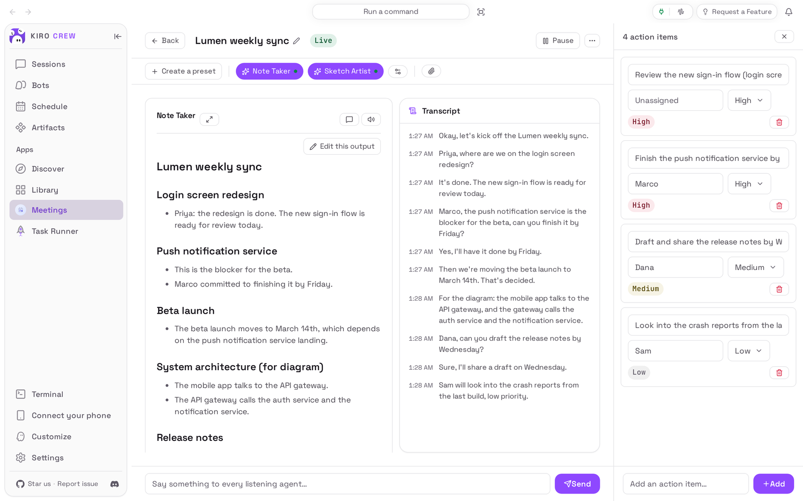
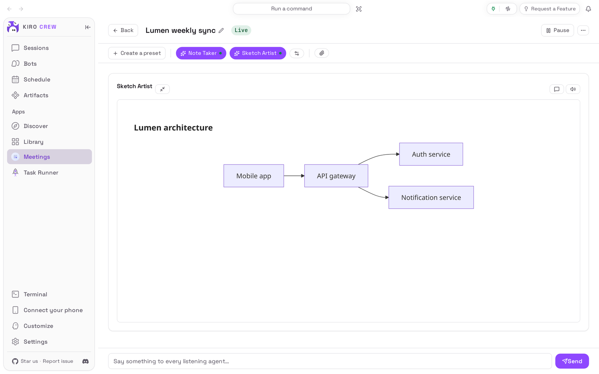
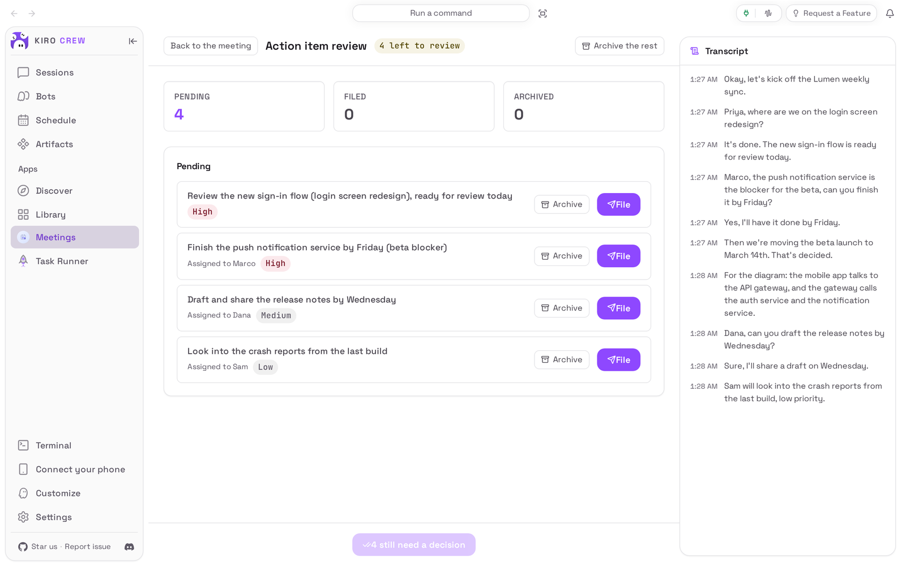

# Meetings

<picture>
  <source media="(prefers-color-scheme: dark)" srcset="docs/media/hero-dark.png">
  
</picture>

**Talk through your meeting. Get the notes, a diagram and the action items as you go.**

Meetings is an app for [Kiro Crew](https://github.com/kirodotdev/KiroCrew),
the open-source personal AI agent.

## What it is

Meetings adds a **Meetings** page and three agents to Kiro Crew. When you start a
meeting, Kiro Crew listens through your microphone and writes down what is said.
While the meeting runs, the **Note Taker** keeps structured notes, the **Sketch
Artist** draws the architecture or workflow being discussed, and a third agent
lists the action items. When you end the meeting you go through each action item
and decide whether to file it or archive it.

**Get started:** open **Apps → Library**, open the **⋯** menu on **Meetings** and
choose **Enable**. [Install](#install) has the details.

## The problem it solves

In a meeting you either talk or take notes. Whoever writes them down misses half
the discussion, the notes come out a day later, and the "who said they would do
what" part is the first thing to get lost. Recording the call and reading a
transcript afterwards does not help much either: an hour of transcript is not a
list of decisions.

Meetings does the writing while you talk. The notes, the diagram and the action
items fill in during the meeting, on your own computer, with the same AI model the
rest of your Kiro Crew uses, and nothing is filed anywhere until you have looked
at it.

## Top 3 use cases

### 1. Keep notes while you talk

Open a meeting and press **Start**. The **Transcript** panel lists each line as it
is recognised, and the **Note Taker** rewrites its notes every half minute or so:
topics, decisions and what each person said they would do. A line under the
transcript shows what was just heard. You can type into **Say something to every
listening agent…** to correct something, and **Edit this output** lets you fix the
notes yourself without the agent overwriting your edit.


### 2. See the system you are discussing drawn out

When someone describes how the parts fit together, the **Sketch Artist** turns it
into a diagram and keeps revising that one diagram as the picture becomes
clearer. Press the expand button next to **Sketch Artist** to give it the whole
page, and press it again to go back. In this run the meeting said "the mobile app
talks to the API gateway, and the gateway calls the auth service and the
notification service", and the agent drew exactly that.



### 3. Review the action items before anything is filed

Open **⋯ → Action items** at any time to see and edit the list (description,
person, priority). When the meeting is over, choose **⋯ → End and review**. Each
item has **File**, which records it in your task list, and **Archive**, which
drops it. **Close the meeting** stays unavailable until every item has a decision.



## Watch it


[Watch the walkthrough as a video (MP4)](docs/media/walkthrough.mp4).

<sub>Recorded from a real Kiro Crew dashboard (Kiro Crew `55439d8770`, with this
repository installed into a throwaway home in place of the copy that comes with
Kiro Crew) with a made-up meeting about a made-up mobile app. The recording
computer had no microphone, so the spoken lines are scripted ones handed to the
page in place of speech recognition; the page then showed and sent them to the
agents exactly as it does real speech. The notes, the diagram and the action
items came from a live AI model and will vary from run to run. Waits for the
agents were shortened. The recording is a separate, shorter run than the
pictures above, so its notes and action items differ from theirs.</sub>

## Install

**Today: Meetings comes with Kiro Crew.** Nothing needs downloading. It starts
switched off:

1. In Kiro Crew, open **Apps → Library** in the left sidebar.
2. Choose **Show N disabled apps** (N is how many apps are switched off).
3. On the **Meetings** tile, open the **⋯** menu and choose **Enable**.
4. **Meetings** now appears under **Apps** in the sidebar.

**Coming later: from the Kiro Crew App Store.** Once this app is listed there:

1. Open **Apps → Discover** in the left sidebar.
2. Search for **Meetings** and choose **Install**.
3. Kiro Crew asks **Trust “Meetings” to run its own code?** Meetings runs a small
   program of its own inside Kiro Crew to keep your meetings, run its agents and
   read your calendar. Trusting it gives that program the same access Kiro Crew
   has (your files, your saved sign-ins and the internet), as the dialog says. If
   you are happy with that, choose **Trust this app**. You can take it back later
   in **Settings → Security → Third-party apps**.
4. The app installs switched off. Choose **Enable** on its page.

What you need: Kiro Crew on a Mac, Linux or Windows computer, already able to
chat, and a browser or desktop app that may use your microphone. Live
transcription uses Kiro Crew's own speech-to-text: in **Settings → Voice**, speech
input must be on, with a provider that can stream and **Streaming** turned on. No
account or key is needed for the app itself.

## First run

Open **Meetings** from the sidebar. The page is empty: **No meetings**. Choose
**New meeting** to start one straight away, or, if you keep a calendar, open
**Settings** first and point **Calendar** at it (see
[How to use it](#how-to-use-it)). The first time you press **Start**, your browser
asks to use the microphone; allow it. Starting a meeting takes a few seconds while
the agents get ready; what is said in that time is kept and passed on.

## How to use it

1. **Open a meeting.** Choose **New meeting**, or pick a meeting in **All
   meetings** (from your calendar, or one you worked on before). The pencil next to
   the title renames it.
2. **Start.** Press **Start**. The status changes to **Live** and the transcript
   begins. Only one meeting can be live at a time.
3. **Pick the agents.** The pills under the title turn the **Note Taker** and the
   **Sketch Artist** on and off for this meeting; the speaker button on a panel
   mutes that agent. The action-item agent always runs. **Create a preset** saves
   the current choice.
4. **Steer them.** Type into **Say something to every listening agent…** and
   **Send** to add context or correct a mistake. The speech bubble on a panel
   opens a chat with just that agent.
5. **Keep your own note.** **⋯ → My note** opens a note of your own beside the
   agents' output; you can paste a screenshot into it and it is stamped with the
   meeting's elapsed time.
6. **Pause.** **Pause** stops listening; **Resume** carries on.
7. **End and review.** **⋯ → End and review**, then **File** or **Archive** each
   action item, or **Archive the rest**. **Close the meeting** finishes it. You
   can reopen an ended meeting later.
8. **Settings** (on the Meetings page): **Task provider** decides where **File**
   puts an item (the shipped one keeps a task list inside Kiro Crew). **Live
   translation** shows each line in another language in a side panel (**⋯ →
   Translation**); it costs one model call per line, so it is off by default.
   **Calendar** reads an iCalendar (`.ics`) file on this computer or a published
   `https://` calendar address; **Sync calendar** reads it now, and the app also
   re-reads it every few minutes and prepares a meeting shortly before it starts.
   **Agents** sets which agents a new meeting starts with. **Speech dictionary**
   fixes a word speech recognition keeps getting wrong (for example a product
   name): add the correct spelling and the ways it is misheard, and every later
   line is corrected before the agents see it.

Limits worth knowing: the agents write roughly every 30 seconds, not word by word.
They see the transcript, the meeting title and any links or files you attach,
nothing else. They never file an action item themselves; only **File** does.

## Settings & data

- **Where your data lives:** in `~/.kiro/crew/apps/meetings/data/` (or the same
  place under the folder you chose for Kiro Crew's data): each meeting's
  transcript, notes, diagram and action items, your own notes and edits, the
  speech dictionary, the calendar cache and the local task list. Audio is not kept.
- **What goes over the internet:** the agents use the same AI model as the rest of
  your Kiro Crew, so the transcript reaches that model. Speech recognition goes
  wherever your **Settings → Voice** provider sends it (the local provider stays on
  this computer). A calendar given as an `https://` address is downloaded from
  there. Meetings itself uploads nothing.
- **Who can use it:** anyone using this Kiro Crew can see the meetings, but only
  the person who set it up can start, change or delete one, or change the settings.
- **Turn it off:** **Apps → Library**, the **⋯** menu on Meetings, **Disable**. A
  live meeting is ended first and its last lines are saved. Your meetings are kept.
- **Remove it** (once it is installed from the App Store): the same menu,
  **Uninstall**. **Keep app data** is ticked; untick it to delete your meetings too.

## Troubleshooting / FAQ

**"Transcription is unavailable" or "Live transcription is off".**
Kiro Crew's speech-to-text is not ready. In **Settings → Voice**, turn speech
input on, pick a provider that can stream, and turn **Streaming** on. You can
still type into the message box to feed the agents.

**"Microphone access was denied".**
Allow the microphone for Kiro Crew in your browser (the icon in the address bar),
or on a Mac in **System Settings → Privacy & Security → Microphone**, then press
**Resume** or start again.

**"Another meeting is already running. End it first."**
Only one meeting can run at a time. Return to it from the banner on the Meetings
page (**Return to the meeting**) and choose **⋯ → End and review** there first.

**The agents stopped after repeated failures.**
The model could not be reached several times in a row. Check that Kiro Crew can
chat, then choose **Retry** in the notice.

**The calendar does not show my meetings.**
Check the path or address in **Settings → Calendar**. Only `https://` addresses
are accepted, and an address that points inside your own network is refused on
purpose.

**A change is refused, saying only the owner may do it.**
You are using a Kiro Crew someone else set up; only its owner can change
meetings.

## Development

This repository is the externally packaged form of the `meetings` app that ships
built into Kiro Crew. The two share a name, a version, the same permissions and
the same three agents, so the Kiro Crew release that adds built-in adoption can
move an existing built-in install onto this source in place, at a commit pinned in
that release: every meeting stays where it is. Until a user's Kiro Crew does that,
it keeps running its built-in copy, and nothing here changes what they run.
[PORTING.md](PORTING.md) lists every place this copy differs from the built-in and
why, and every gap that still needs a Kiro Crew change.

| Path | What it is |
|---|---|
| `app.json` | The manifest: the three agents, the skill, `backend.hooks`, the `ui` entry and the `l10n` listing copy |
| `agents/` | The Note Taker, Sketch Artist and Task Extractor agent specs |
| `skills/meetings` | The skill that tells a general chat where a meeting's data lives |
| `backend/hooks.py` | The hook entry points (`register_routes`, `on_startup`, `on_shutdown`) |
| `backend/routes/` | The routes the gateway serves under `/api/apps/meetings`; changes are owner-gated |
| `backend/domain/`, `store.py` | The meeting session and its agent queues, the dictionary, translation, the on-disk layout |
| `backend/providers/` | The task and calendar provider seams (a local task list, an iCalendar reader) |
| `backend/_host.py` | The only module that touches the gateway |
| `backend/_compat.py`, `_fs.py` | Small helpers restated from Kiro Crew |
| `ui/src/` | The dashboard page (React), built against `@kirocrew/app-sdk` |
| `ui/i18n/` | The page's strings in every language the dashboard ships |
| `ui/dist/index.mjs` | The built page, **committed**: an install is a plain clone with no build step |
| `ui/pcm-worklet.js` | The microphone capture worklet, served beside the bundle |
| `ui/tests/` | UI tests (vitest + happy-dom), with light stand-ins for the host SDK |
| `assets/` | Store icon, hero art and screenshot (raster, as the catalog requires) |
| `tests/` | Backend and manifest tests, runnable offline with pytest |
| `capture/` | Captures the README media from a real, isolated Kiro Crew ([capture/README.md](capture/README.md)) |
| `docs/media/` | The README pictures and walkthrough, plus `media.json` (sizes, alt text, commits) |

### What it needs from Kiro Crew

Kiro Crew 0.13.0 or later (`minKiroCrewVersion`): App Kit level 1, which gives an
app's hooks an owner gate (`ctx.require_owner`) and structural route records.
Meetings also uses `ctx.scrub` (redaction of everything it stores or shows),
`ctx.audit` (the security event log) and `ctx.data_dir`.

The agents' turns must run on the gateway's session manager through its tool gate
and fair-admission gate, calendar text must pass its injection screen and
untrusted-data fence, a calendar URL its SSRF check, and a recording its file gate
and descriptor-pinned copy; no App Kit seam offers those yet. `backend/_host.py`
therefore looks them up in the gateway by name at the moment it needs them, and
when one is missing it refuses the operation instead of running it unprotected;
`register_routes` reports what is missing through the app's health. No other
backend module names `kiro_crew` (`tests/test_no_host_imports.py`).

### Install from a clone

```bash
git clone https://github.com/KiroCrewCaptain/kirocrew-app-meetings
kirocrew app install ./kirocrew-app-meetings
```

Then turn it on from **Apps → Library**. The app runs its own code
(`backend.hooks` in `app.json`), so Kiro Crew will not enable it until you trust
it: the Library's **Enable** opens **Trust “Meetings” to run its own code?**, and
**Trust this app and enable** does both. While your Kiro Crew still has the
built-in copy installed, the install is refused: `app 'meetings' is already
installed`. `kirocrew app disable meetings` turns the app off, and
`kirocrew app uninstall meetings` (add `--purge-data` to delete the meetings)
removes an installed copy.

### Tests

Backend and manifest:

```bash
python -m pip install -r tests/requirements.txt
python -m pytest
python -m flake8 backend tests capture
```

These need neither Kiro Crew nor the network. `tests/fakehost.py` stands in for
the gateway's controls and for the app context; `tests/harness.py` serves the
routes the way the gateway's route registry does. To run the same suite against a
real Kiro Crew's controls, set `MEETINGS_REAL_HOST=1` and put that checkout's
`src/` on `PYTHONPATH`, in an interpreter with Kiro Crew's dependencies.
`KIROCREW_SRC=<checkout>` also runs `tests/test_manifest_host_parser.py`, which
reads `app.json` with Kiro Crew's own manifest parser.

UI (Node 24, from `ui/`):

```bash
npm ci
npm run typecheck
npm test
npm run build
```

`npm run build` writes `ui/dist/index.mjs`. Commit it with the source change that
produced it: CI rebuilds it from a clean `npm ci` and fails if the result differs.
The bundle imports only the modules the dashboard provides, plus framer-motion and
react-virtuoso, which it bundles; `tests/test_manifest_contract.py` checks that,
and that every name it imports by name exists on a Kiro Crew without the level-1
seams. A UI string goes into `ui/i18n/en.json` and every other catalog there.

### Re-capture the README media

The pictures and the recording come from a real, isolated Kiro Crew gateway driven
by [`capture/`](capture/README.md), with a live model for the agents. While Kiro
Crew still ships the built-in Meetings, run it on a Kiro Crew tree with the
built-in removed (`git rm -r src/kiro_crew/apps/builtins/meetings` and its
`BUILTIN_NAMES` row) and the dashboard built in that tree, from a clean clone of
this repository:

```bash
python capture/capture.py --kirocrew /path/to/that/tree
python capture/check_readme.py README.md
```

Then look at every picture and a few frames of the video, and make the alt text
and this README say only what the agents actually wrote.

## License

Apache License 2.0; see [LICENSE](LICENSE) and [NOTICE](NOTICE). The app was
written by adunuthu; see [ATTRIBUTION.md](ATTRIBUTION.md).
